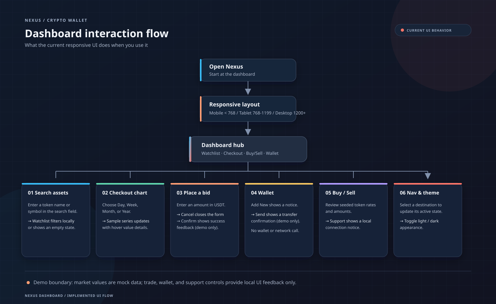

# Nexus Crypto Wallet Dashboard

A responsive Flutter dashboard for viewing a mock crypto watchlist, checkout chart, buy/sell summaries, and wallet controls.

## Dashboard Flow

The flow covers the interactions currently wired in the UI. Market data is seeded demo data; bid, send, add-wallet, and support actions show local UI feedback and do not contact a backend.

The editable vector source is [assets/images/dashboard_flow.svg](assets/images/dashboard_flow.svg).
